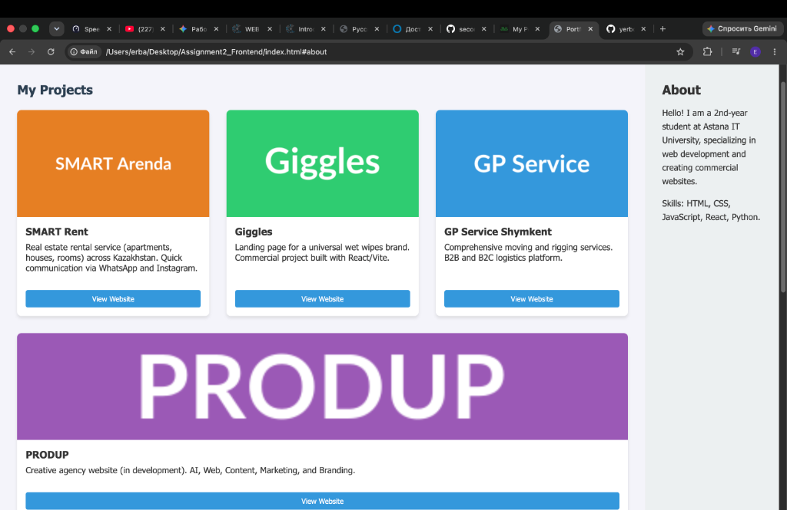
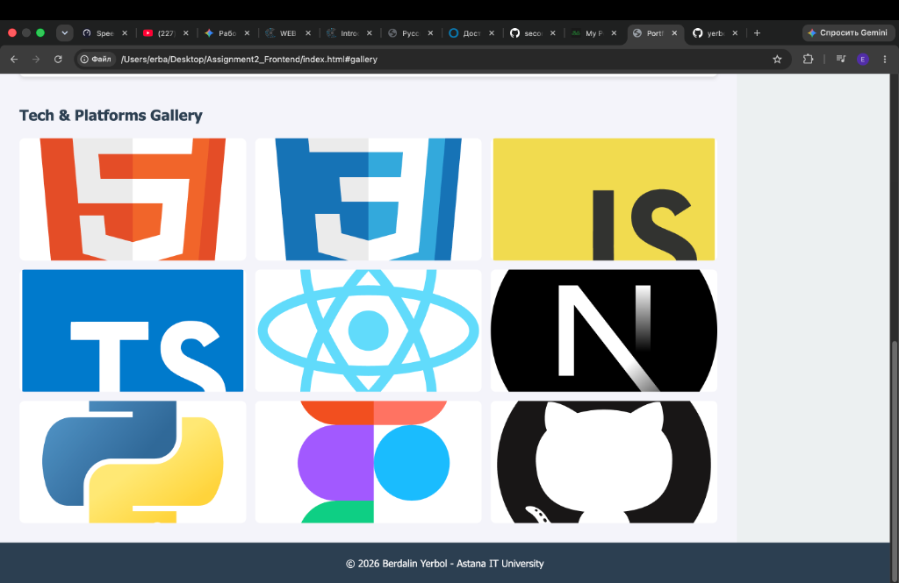

# Assignment 2: Advanced CSS (Flexbox & Grid)

**Name:** Berdalin Yerbol  
**Group:** IT-2513  

## Overview
This repository contains my submission for the Frontend Web Development assignment focusing on advanced CSS layouts. The goal was to build a fully responsive, modern portfolio page using pure HTML and CSS, strictly avoiding external CSS frameworks like Bootstrap or Tailwind.

## Technical Implementation

### Part 1: Flexbox (Tasks 0 & 1)
- **Navigation Bar:** Implemented a horizontal navigation menu using `display: flex`. Space between the logo and links was managed using `justify-content: space-between`, ensuring a clean header layout.
- **Project Cards:** The featured projects section uses a Flexbox container (`display: flex; flex-wrap: wrap;`) to dynamically align the project cards. Each card acts as a flex item, adapting to the screen size while maintaining consistent heights.

### Part 2: CSS Grid (Tasks 2 & 3)
- **Main Page Skeleton:** The overall layout (Header, Sidebar, Main Content, Footer) was structured using CSS Grid. I utilized `grid-template-areas` to cleanly position the semantic tags (`<header>`, `<aside>`, `<main>`, `<footer>`).
- **Tech & Platforms Gallery:** Developed a robust 3-column image gallery using `display: grid; grid-template-columns: repeat(3, 1fr)`. Local SVG icons of modern web technologies were used, integrated with smooth CSS transition hover effects for interactivity.

### Part 3: Synthesis (Task 4)
- **Portfolio Assembly:** All components were integrated into a single cohesive portfolio page. The layout places the main projects area on the left and the profile sidebar on the right, fulfilling the final assignment synthesis requirements. No JavaScript was used for the layout mechanics.

---

## Final Result Screenshots

### Portfolio Layout & Flexbox Cards

### CSS Grid Image Gallery

